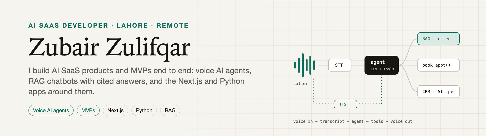

<picture>
  <source media="(prefers-color-scheme: dark)" srcset=".github/assets/header-dark.png">
  
</picture>

## AI SaaS Developer &nbsp;|&nbsp; Voice AI Agents &nbsp;|&nbsp; MVPs with Next.js, Python & RAG

I turn an AI product idea into a working SaaS: the voice or chat agent, the retrieval behind it, and the
real application around it, with sign-in, teams, billing, an admin side, tests and deployment. Five years
of full-stack engineering, currently **Lead Software Engineer at Pynwheel**, previously the technical lead
of a workflow engine that runs millions of executions a day.

  
  
  

### What I build for clients

| Service | What it includes |
|---|---|
| **Voice AI agents** | Receptionists and phone-style assistants that listen, understand and act: speech-to-text, an LLM agent with tool calls (book, look up, update), and natural text-to-speech. Hosted APIs or self-hosted open models. |
| **AI SaaS MVPs** | From idea to a product people can sign up for: Next.js front end, Python or Node API, PostgreSQL, multi-tenant accounts, roles, Stripe billing and an admin dashboard. |
| **RAG chatbots and knowledge assistants** | Answers grounded in your documents, websites or database, with citations, a confidence gate for questions they can't answer, and an embeddable widget. |
| **AI features in an existing product** | Structured LLM outputs, AI agents and automations added to a running app, with human approval where it matters and logs you can audit. |

### Featured projects

**Voice AI**

- **[DentalVoice AI](https://github.com/Qubit-Labz/Dental-Receptionist-Voice-AI)** &nbsp;`Python` `FastAPI` `React` &nbsp;·&nbsp; *Qubit Labz team project* 
  A voice receptionist for a dental clinic. Faster-Whisper transcribes the caller, an LLM agent with tool calls resolves dates and books the appointment, and Kokoro answers in a natural voice. The React front end has a live waveform, sign-in and an appointments view. It can run entirely on self-hosted open models.
- **[Waivs.ai](https://github.com/Zubair-Zulifqar/Waivs-AI)** &nbsp;`Next.js` `Supabase` `Vertex AI` 
  Voice to clinical notes for surgical teams. Browser recording with crash recovery, Google Speech-to-Text with speaker diarization, then a source-cited draft note from Gemini that a clinician must approve. Version history, word-level diffs and PDF export.

**RAG and AI agents**

- **[Othego](https://github.com/Zubair-Zulifqar/Othego)** &nbsp;`TypeScript` `RAG` `Stripe` 
  An AI support chatbot SaaS. Businesses connect websites, sitemaps and PDFs; Othego crawls, chunks and indexes them, then answers visitors through a 5 kB embeddable widget. Hybrid BM25 and vector search, reranking, cited streaming answers, lead capture, analytics and four Stripe plans.
- **[Tuck Advisors Platform](https://github.com/Zubair-Zulifqar/Tuck-Advisors-Platform)** &nbsp;`TypeScript` `Python` 
  An AI research and CRM platform for an M&A advisory: an AI research engine, explainable fit scoring, CRM automation with approval gates, and a Chrome extension that works inside LinkedIn and Gmail. Every AI claim is labelled *sourced*, *assessment* or *unknown*.
- **[SmartPrep](https://github.com/Qubit-Labz/smartprep-ai)** &nbsp;`FastAPI` `Mistral` `WebRTC` &nbsp;·&nbsp; *Qubit Labz team project* 
  A mock-interview simulator. The LLM generates questions from the role a user picks, scores text and video answers, and streams feedback.

**AI SaaS MVPs**

- **[TestFiesta](https://github.com/Zubair-Zulifqar/TestFiesta)** &nbsp;`Vue` `Express` `PostgreSQL` 
  Test management SaaS with an AI copilot that writes test cases from requirements. Each customer gets its own database, with relationship-based permissions, Jira and GitHub sync, and a CLI for CI results.
- **[StoryHEAT](https://github.com/Zubair-Zulifqar/StoryHEAT)** &nbsp;`Next.js` `Python` 
  Campaign message testing: AI drafts narratives from supplied facts, real audiences rate them in surveys, and a heatmap shows what landed. Includes a content assistant that drafts social posts from approved material.
- **[Authentic Spark](https://github.com/Zubair-Zulifqar/Authentic-Spark)** &nbsp;`Next.js` `Python` `GCP` 
  An all-in-one operations platform for agencies: email planning, list cleaning, SMS compliance, ad review, QuickBooks invoicing and six AI agents with approval steps, deployed on Cloud Run.

Each repo has a README covering setup, architecture and status, plus automated tests, and runs locally in a mock mode with no paid API keys needed.

### What you get on a project

- A working product early, then steady progress you can click through, not just status updates.
- Production basics from the start: authentication, roles, tenant isolation, billing, error handling and logging.
- AI that is safe to put in front of customers: cited answers, structured outputs, human approval for anything that goes out, and no invented numbers.
- Clean handover: documented setup, environment templates, Docker, and tests you can run.

### Production experience

- **Lead Software Engineer, Pynwheel** (2026 to now): property-tech SaaS with interactive maps, shortest-path wayfinding and a self-guided tour mobile app on one React/TypeScript codebase.
- **Senior Software Engineer, EZO** (2023 to 2026): led a workflow engine running millions of executions a day across three products, cut a 12–15 hour device sync to under an hour, and built AI automation that turns production errors into proposed pull requests.
- AWS Certified Cloud Practitioner &nbsp;·&nbsp; Silver medal, ICPC Asia Topi Regional &nbsp;·&nbsp; BS Software Engineering, PUCIT

### Stack

  
  
  
  
  
  
  
  
  
  
  
  
  
  
  
  
  

### Let's build yours

Have an AI product idea or a voice agent to ship? Send me the brief on
**[Upwork](https://www.upwork.com/freelancers/~01894c735c70746190)** and I'll reply with how I'd build it
and a first milestone.

[Upwork](https://www.upwork.com/freelancers/~01894c735c70746190) &nbsp;·&nbsp; [Portfolio](https://zubair-zulfiqar.vercel.app) &nbsp;·&nbsp; [LinkedIn](https://www.linkedin.com/in/zubair-zulfiqar-17413226b/) &nbsp;·&nbsp; [Resume (PDF)](https://zubair-zulfiqar.vercel.app/Zubair_Zulfiqar_Resume.pdf)

Earlier work, from university: Android, Java, C# and C++, in the 2021–2024 repos below.
